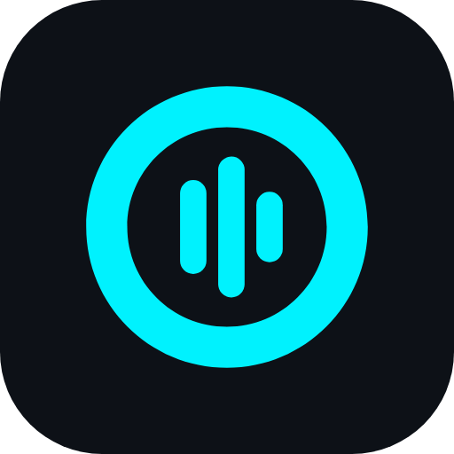
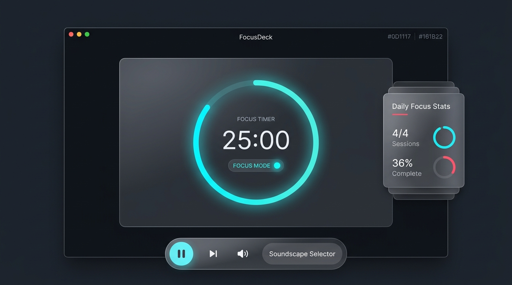
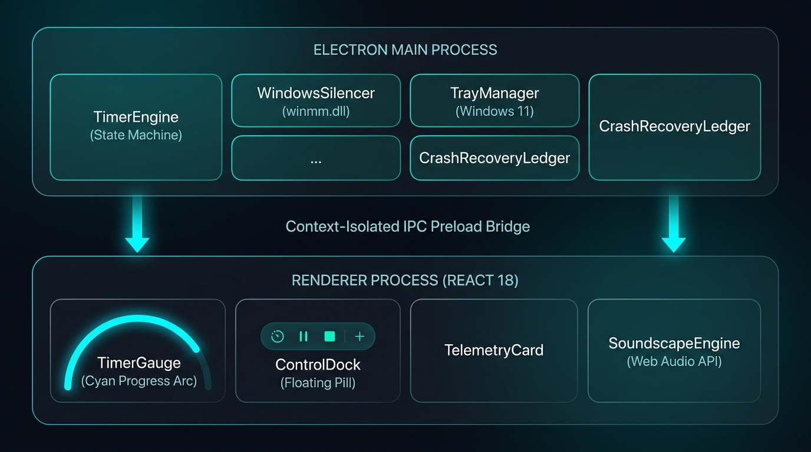

<div align="center">
  
  <h1>HushLoop</h1>
  <p><strong>Active Pomodoro Desktop Timer for Windows 11</strong></p>
  <p><i>Automated Distraction Silencing • Procedural Web Audio Soundscapes • Native Tray & Global Hotkeys</i></p>

[](https://github.com/ronaldgosso/hushloop/actions/workflows/build-and-test.yml)
[](https://www.typescriptlang.org/)
[](https://react.dev/)
[](https://www.electronjs.org/)
[](https://vitejs.dev/)
[](https://vitest.dev/)
[](https://microsoft.com/windows)

</div>

---

## 🎨 Brand Identity: The Acoustic Loop

<div align="center">
  
</div>

HushLoop's brand mark embodies **The Acoustic Loop**:
- **Outer Unbroken Focus Ring**: Represents continuous, uninterrupted focus flow and cyclical Pomodoro intervals.
- **Central Sound-Damping Bar Array**: Three vertical acoustic pills that visually attenuate sound vibrations down to absolute calm and hush.
- **Electric Cyan Glow (`#00F2FE`)**: Signals active silence mode, high cognitive clarity, and Windows 11 Fluent dark synergy.

---

## 📸 Visual Identity & Architecture

HushLoop's visual language is inspired by the **Dentale EHR Healthcare Desktop App** design aesthetic:

- **Futuristic Dark Glassmorphism**: Surface panels (`rgba(22, 27, 34, 0.72)`) over deep space obsidian (`#0D1117`) with 16px backdrop blur.
- **Electric Cyan Progress Indicator**: Vibrant glowing arc (`#00F2FE` and `#4EEDDE`) visualizing focus progress.
- **Coral Break State**: Warm coral accents (`#FF4B72`) signaling mindful rest intervals.
- **Floating Pill Dock**: Ergonomic bottom floating dock with instant audio and session controls.
- **Frameless Window Bar**: Custom drag region with Windows 11 status pulse indicator and window controls.



---

## 🏛️ System Architecture

FocusDeck is engineered with strict process isolation and unidirectional data flow:



---

## ✨ Core Features

### 1. Drift-Resistant Pomodoro Engine

- **Timestamp Delta Tracking**: Unlike naïve `setInterval` counters, `TimerEngine` computes elapsed time against absolute epoch timestamps (`Date.now()`). It is completely immune to clock drift caused by Windows 11 power-saving suspend, sleep, or window minimization.
- **Finite State Machine**: Strict state validation (`idle`, `running`, `paused`) and automatic cyclical phase transitions (Focus ➔ Short Break ➔ Long Break every 4 intervals).

### 2. Active Windows 11 Distraction Silencing

- **`SystemSilencer` Interface**: Modular driver architecture abstracting platform-specific volume manipulation.
- **`WinMMAudioDriver`**: Low-overhead native audio interop through Windows Multimedia (`winmm.dll`), dynamically ducking or muting master output during focus sessions and restoring it when breaking.
- **Write-Ahead Crash Ledger**: Records original system volume to `%APPDATA%\FocusDeck\silencer-session.json` prior to any volume alteration. If Windows crashes or power drops, FocusDeck automatically restores audio on next launch and displays a recovery banner.

### 3. Procedural Zero-Asset Soundscapes

- **Web Audio API Synthesis**: Generates rich, continuous acoustic environments directly in code without downloading or bundling large MP3 audio files.
- **Alpha Waves (432 Hz)**: Dual binaural sine wave synthesis inducing relaxed, hyper-focused cognitive flow.
- **Rain Ambience**: Pink noise filtered through dual resonant Biquad low-pass filters with slow random oscillation.
- **Completion Chimes**: Harmonically tuned bell envelope announcing session transitions.
- **Strict CSP Compliant**: Runs under high-security Content Security Policy (`media-src 'self' data:; connect-src 'self'`).

### 4. Background Tray & Global Hotkeys

- **Native Tray**: Minimizes to the Windows 11 system notification area with a live remaining-time tooltip and right-click control menu.
- **Global Shortcut (`CommandOrControl+Alt+F`)**: Toggle play/pause from any active application without switching window focus.

### 5. Persistent Telemetry & Streaks

- **Daily Progress Tracking**: Aggregates total daily focus minutes, session completions, and calendar streaks into `%APPDATA%\FocusDeck\stats.json`.
- **User Preferences**: Configurable session intervals, hotkey bindings, and silencing toggles persisted in `%APPDATA%\FocusDeck\settings.json`.

---

## 🪟 Windows 11 Silencing Reality & Limitations

Windows 11 enforces strict process sandboxing regarding OS-wide notifications:

- **No Public Unprivileged DND API**: Windows 11 _Do Not Disturb / Focus Assist_ settings are managed via internal WinRT interfaces (`Windows.UI.Notifications.Management.UserNotificationListener`) that require elevated Administrator privileges or AppContainer package identity.
- **Our Honest Approach**:
  1. Automated master volume ducking/muting via native `winmm.dll` audio drivers to suppress auditory alerts and system noises.
  2. Native desktop notifications on session transition with action prompts.
  3. Guidance provided to users for toggling Windows 11 Focus Mode via the native shortcut: `Win + N`.

For complete details, see [docs/WINDOWS_SILENCING.md](docs/WINDOWS_SILENCING.md).

---

## 🚀 Quickstart & Development

### Prerequisites

- **Node.js**: v20+ (tested on Node v24.19.0)
- **npm**: v10+
- **Platform**: Windows 11 (or Windows 10)

### Installation

```powershell
# Clone the repository
git clone https://github.com/ronaldgosso/hushloop.git
cd hushloop

# Install dependencies
npm install
```

### Running Locally

```powershell
# Launch the Vite development server + Electron runtime
npm run dev
```

### Running Tests & Quality Checks

```powershell
# Run the 52 unit tests
npm test

# Run test coverage audit (99.77% overall coverage)
npm run test:coverage

# Lint TypeScript code
npm run lint

# Format code with Prettier
npm run format
```

## 📥 Download Pre-Built Releases

You can download ready-to-run Windows 11 binaries directly from GitHub:
👉 **[Download Latest HushLoop Release](https://github.com/ronaldgosso/hushloop/releases/latest)**

| Package Format                    | Filename                       | Best For                                                                      |
| --------------------------------- | ------------------------------ | ----------------------------------------------------------------------------- |
| **Setup Installer (`.exe`)**      | `HushLoop Setup <version>.exe` | Standard Windows installation with desktop & Start Menu shortcuts.            |
| **Enterprise Installer (`.msi`)** | `HushLoop <version>.msi`       | System administrators deploying via Active Directory GPO or Microsoft Intune. |
| **Portable App (`.exe`)**         | `HushLoop <version>.exe`       | Instant execution without installation (run from thumb drive or any folder).  |

---

### Packaging Windows Release Artifacts (EXE & MSI)

HushLoop supports multiple Windows distribution targets:

#### 1. Windows NSIS Setup Installer (`.exe`)

Builds a standard Windows installer with desktop and Start Menu shortcuts:

```powershell
npm run package:exe
```

Output: `release/HushLoop-Setup-1.2.0.exe` (~84 MB)

#### 2. Windows MSI Enterprise Installer (`.msi`)

Builds a Windows Installer package via WiX Toolset, ideal for enterprise mass-deployment via Group Policy (GPO) or Microsoft Intune:

```powershell
npm run package:msi
```

Output: `release/HushLoop-1.2.0.msi` (~94 MB)

#### 3. Portable Standalone Application (`.exe`)

Builds a single self-contained executable that runs immediately without installation:

```powershell
npm run package:portable
```

Output: `release/HushLoop-Portable-1.2.0.exe` (~84 MB)

#### 4. Unpacked Development Directory (`.exe`)

Builds an unpacked directory for immediate smoke testing without archiving:

```powershell
npm run package:dir
```

Output: `release/win-unpacked/HushLoop.exe`

#### 5. Build All Formats Simultaneously

```powershell
npm run package:all
```

---

### 🏷️ Publishing a Versioned GitHub Release

To release a new version with automated `.exe` and `.msi` builds attached:

```powershell
# 1. Update version in package.json (e.g. 0.1.0)
npm version 0.1.0 --no-git-tag-version

# 2. Create and push a version git tag
git tag -a v0.1.0 -m "Release v0.1.0"
git push origin v0.1.0
```

GitHub Actions automatically runs the [Release Windows Executable](.github/workflows/release.yml) workflow:

1. Runs tests and linters on `windows-latest`.
2. Packages NSIS `.exe`, WiX `.msi`, and Portable `.exe`.
3. Creates a new GitHub Release tagged `v0.1.0`.
4. Attaches all installer binaries for users to download.

---

## 🧪 Acceptance Criteria Checklist

| #      | Acceptance Criterion                                        |    Status     | Implementation Details                                                                    |
| ------ | ----------------------------------------------------------- | :-----------: | ----------------------------------------------------------------------------------------- |
| **1**  | Pure TS Pomodoro state machine with 90%+ test coverage      | ✅ **Passed** | `TimerStateMachine` + `TimerEngine` tested with **99.77% coverage** across 52 unit tests. |
| **2**  | Timestamp-based elapsed calculation immune to Windows sleep | ✅ **Passed** | Absolute epoch timestamps (`Date.now()`) with paused duration tracking in `TimerEngine`.  |
| **3**  | Active silencing behind `SystemSilencer` interface          | ✅ **Passed** | Clean abstraction `SystemSilencer` with `WindowsSilencer` and mock test drivers.          |
| **4**  | Honest Windows 11 DND analysis & winmm.dll implementation   | ✅ **Passed** | Documented in `docs/WINDOWS_SILENCING.md`; master volume ducking/muting automated.        |
| **5**  | Crash recovery restoring volume on next launch              | ✅ **Passed** | Write-ahead `CrashRecoveryLedger` with startup recovery and UI banner notice.             |
| **6**  | Procedural Web Audio soundscapes (Alpha waves, Rain)        | ✅ **Passed** | Zero MP3s; procedural pink noise and 432Hz sine synthesis in `SoundscapeEngine`.          |
| **7**  | Windows 11 notification and Tray integration                | ✅ **Passed** | `NotificationManager` + `TrayManager` with context menu and minimize-to-tray.             |
| **8**  | Persistent daily stats (minutes, streaks)                   | ✅ **Passed** | `StatsTracker` + `StatsStore` persisting to `%APPDATA%\FocusDeck\stats.json`.             |
| **9**  | Dentale EHR dark glassmorphic UI + global hotkey            | ✅ **Passed** | Cyan glow, floating dock, `GlobalHotkeyManager` with `CommandOrControl+Alt+F`.            |
| **10** | Windows NSIS installer packaged via electron-builder        | ✅ **Passed** | Configured in `electron-builder.json`, outputs to `release/`.                             |

---

## 📄 License

MIT License. Created by [Ronald Gosso](https://github.com/ronaldgosso).
