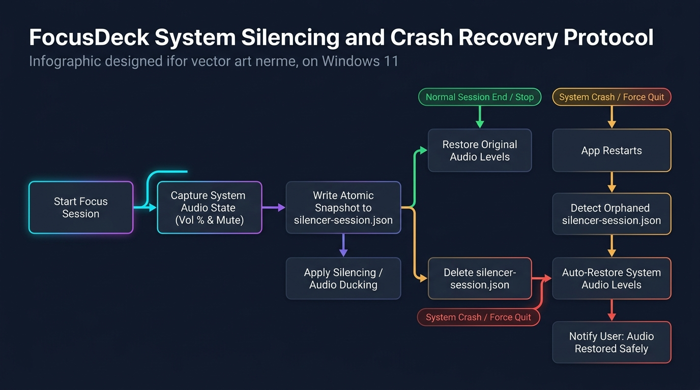

# Windows 11 Silencing: Technical Analysis & Honest Evaluation

One of the core promises of FocusDeck is to actively silence distractions on Windows 11 when a focus session starts and restore normal operation when it finishes. This document provides an honest, production-grade assessment of what Windows 11 allows, what is technically restricted, and how FocusDeck implements reliable silencing.

---

## 1. The Windows 11 Distraction Landscape

On Windows 11, interruptions come in three primary forms:
1. **Audio noise**: System alert sounds (beeps, mail pings, Slack/Teams chimes, USB disconnect chimes).
2. **Visual banners (Toasts)**: Notification popups sliding into the bottom-right action center.
3. **App badges & flashes**: Taskbar icons flashing orange.

---

## 2. Windows 11 Technical Constraints & Capabilities

### 2.1 Audio Silencing (Fully Feasible & Reliable)
- **Mechanism**: Windows Core Audio Endpoints (`IAudioEndpointVolume`).
- **Capability**: FocusDeck can read the exact master volume level (`0.0` to `1.0`) and the mute state (`true` / `false`) before a session starts.
- **Action**: FocusDeck can mute master audio or duck it down to a user-configured level during focus, and restore the precise pre-session volume and mute status on completion.
- **Crash Safety**: The pre-session volume and mute state are written to disk before modifying audio. If FocusDeck or the system crashes, startup recovery restores the user's volume.

### 2.2 Notification Silencing & "Do Not Disturb" (Windows 11 Limitations)
- **Historical Context (Windows 10)**:
  Windows 10 featured "Focus Assist" with three modes (`Off`, `PriorityOnly`, `AlarmsOnly`). Applications could read or toggle specific registry keys under `HKCU\Software\Microsoft\Windows\CurrentVersion\Notifications\Settings` or use the undocumented `WpnUserService`.
- **Windows 11 Reality**:
  - In Windows 11 (builds 22000, 22621, 22631, 26100+), Microsoft rebuilt the notification system into "Do Not Disturb" (DND) and unified it with Windows Focus sessions.
  - Microsoft **does not provide a public Win32 or WinRT API** for third-party desktop applications to toggle Windows 11 system-wide Do Not Disturb programmatically.
  - While private COM interfaces or registry manipulation exist, Microsoft frequently breaks them across feature updates (22H2 / 23H2 / 24H2), and direct registry writes to notification state without triggering internal shell events often leave the Windows Shell out of sync until `explorer.exe` restarts.
  - Elevating with administrator permissions to tamper with system services produces invasive UAC prompts that degrade user trust.

---

## 3. FocusDeck's Honest Architecture for Windows 11

Rather than faking DND support or using fragile registry hacks that break on Windows updates, FocusDeck adopts a transparent, multi-tiered approach:

1. **Native Master Audio Silencing / Ducking**:
   - FocusDeck captures and manages the system master volume and mute state via native Windows Core Audio.
   - When focus begins, notification chimes, system pings, and background audio distractions are muted.
   - When break time arrives, the original volume and mute status are restored.

2. **Application-Level Silence**:
   - FocusDeck suppresses all non-critical notifications from itself during active focus.
   - FocusDeck timer chime only fires when transitioning into break or idle.

3. **Assisted Windows 11 Focus Integration**:
   - FocusDeck provides an intuitive shortcut and visual indicator reminding the user to trigger Windows 11 Focus (`Win + N` ➔ `Focus`) if full OS banner suppression is desired.
   - The UI clearly communicates:
     - *"Audio Silencing: Active (System chimes & distractions muted)"*
     - *"Windows 11 DND: Use Win+N for visual banner suppression"*

4. **Extensible `SystemSilencer` Interface**:
   - All silencing behavior is isolated behind the `SystemSilencer` interface (`src/main/silencer/silencer-interface.ts`).
   - If Microsoft exposes a stable Windows App SDK or WinRT API for DND in future updates, or when adding macOS (`DoNotDisturb` via Shortcuts/AppleScript) or Linux (`dunstctl set-paused`), only a new driver implementation is needed.

---

## 4. Crash Recovery Protocol

To guarantee the user is never left with an unexpectedly muted system after a crash:

